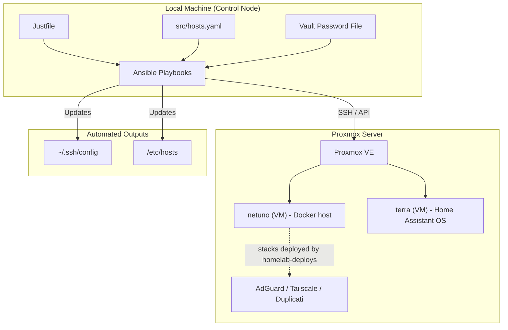
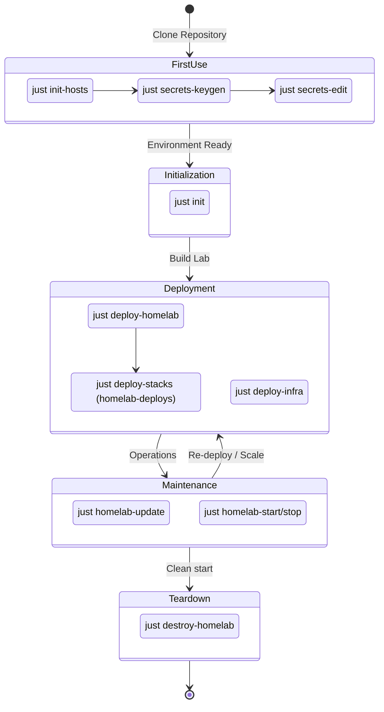

# Homelab IaC (Infrastructure as Code)

  
  
  
  
  
  

## Concept & Proposal

The **Homelab IaC** project is a fully automated solution for deploying and managing a personal infrastructure on **Proxmox**. The core concept is to treat the homelab as a disposable and reproducible environment, allowing for rapid experimentation, scaling, and recovery.

### Proposal:
- **Reproducibility:** Rebuild the entire infrastructure from scratch in minutes.
- **Consistency:** Ensure all VMs follow the same configuration standards.
- **Security:** Use SOPS + Age for secret management and automate SSH key distribution.
- **Modern Stack:** Leverage Ubuntu (Cloud-Init), Docker Compose, Home Assistant OS, and Ansible for orchestration.

### Current scope (Phase 1 — Foundation)
- **`netuno`** (VM, `192.168.1.51`): Docker host. The AdGuard (DNS), Tailscale (subnet router) and Duplicati (backup) stacks run here and are deployed by the sibling project `homelab-deploys` (`just deploy-stacks`).
- **`terra`** (VM): Home Assistant OS, created from the official HAOS image (UEFI/q35).

Kubernetes and the remaining phases (PostgreSQL/Garage consolidation into compose, user apps, media/cloud, GitOps, monitoring) are **roadmap only**: they are added back to the code gradually, one phase at a time.

---

## Prerequisites & Dependencies

The project relies on several tools and libraries. While the `just init` command attempts to install Python libraries automatically, the core binaries must be present on your system.

### 1. Mandatory System Binaries
Ensure these are installed and available in your `$PATH`:

| Tool | Purpose |
| :--- | :--- |
| [Just](https://github.com/casey/just) | Command runner for all project tasks. |
| [Ansible](https://www.ansible.com/) | Core orchestration and deployment engine (includes Ansible-Vault). |
| [1Password CLI](https://developer.1password.com/docs/cli/) | Secure retrieval of SSH keys and tokens. |
| **Python 3 & Pip3** | Required for Ansible and auxiliary scripts. |

### 2. Python Libraries
These are automatically checked and installed during `just init`:
- `watchdog`: Used for the aesthetic output plugin.
- `paramiko`: Required for custom SSH key management modules.
- `proxmoxer`: Interface for Proxmox API.
- `requests`: HTTP library for API communications.

---

## High-Level Architecture

### Local Files Management

To provide a seamless experience, the project automatically manages several configuration files on your **Local Machine (Control Node)**:

1.  **`~/.ssh/config`**: Configures SSH access to all homelab nodes, including 1Password agent integration.
2.  **`/etc/hosts`**: Maps the IP addresses of all VMs to their respective hostnames for local resolution.

---

## Lifecycle Workflow

The following diagram illustrates the recommended sequence of commands to get your homelab up and running:

---

## Secrets Management (Ansible-Vault)

To keep the repository public and secure, this project uses **Ansible-Vault**. This allows the `src/hosts.yaml` file to remain in Git version control while keeping all sensitive values encrypted.

### 1. Setup
The vault password is stored locally and excluded from Git.

### 2. Initial Setup
1.  **Generate your vault password:** `just secrets-keygen`.
2.  **Prepare your hosts file:** `just init-hosts`.
3.  **Encrypt and Edit:** `just secrets-edit`.

Always use `just secrets-edit` to manage your variables.

---

## Usage (Justfile Commands)

### 1. First Use & Initialization
*Commands to prepare the environment and dependencies.*

| Command | Description |
| :--- | :--- |
| `just init-hosts` | Initializes `src/hosts.yaml` from the sample template. |
| `just secrets-keygen` | Generates a new vault password file in `~/.config/homelab-iac/.vault_pass`. |
| `just secrets-edit` | Decrypts, opens in your editor, and re-encrypts the hosts file on save. |
| `just init` | Installs git hooks, checks dependencies, installs Ansible roles, and configures Proxmox SSH. |

### 2. Deployment
*Commands to provision and configure the infrastructure.*

| Command | Description |
| :--- | :--- |
| `just deploy-homelab` | **Full Deploy:** Full initialization + VM creation (`netuno`, `terra`) + weekly vzdump job. |
| `just deploy-infra` | Provisions only the VMs and configures basic services. |
| `just deploy-vms` | **VMs Only:** Provisions and configures only the VMs (`netuno` Docker host and `terra` Home Assistant OS). |

After the infrastructure is up, run `just deploy-stacks` in `homelab-deploys` to bring up AdGuard, Tailscale and Duplicati on `netuno`.

### 3. Maintenance & Operations
*Commands for daily management and updates.*

| Command | Description |
| :--- | :--- |
| `just homelab-update` | **Full Update:** Updates OS packages on Proxmox nodes, and VMs. |
| `just homelab-update-guests` | Updates OS packages only on the Ubuntu guests (HAOS updates itself). |
| `just homelab-update-proxmox` | Updates OS packages only on Proxmox host nodes (Debian). |
| `just doctor` | Full health check (requires `gum`). |
| `just homelab-start` | Powers on all VMs in the Proxmox host. |
| `just homelab-stop` | Gracefully shuts down all VMs. |

### 4. Teardown
*Commands to clean up the environment.*

| Command | Description |
| :--- | :--- |
| `just destroy-homelab` | **Full Cleanup:** Destroys all guests and cleans local SSH files. |
| `just destroy-infra` | Destroys only the VMs without affecting local files. |
| `just destroy-vms` | Destroys only the VMs (`netuno`, `terra`). |

---

## Project Structure

- `src/`: Contains all Ansible playbooks, roles, and configuration.
- `config-files/`: Templates and user-specific configurations.
- `scripts/`: Auxiliary bash scripts for environment checks and git hooks.
- `images/`: Documentation assets and diagrams.

---

## License

  
   
  Licensed under a <a rel="license" href="http://creativecommons.org/licenses/by-nc-sa/4.0/">Creative Commons Attribution-NonCommercial-ShareAlike 4.0 International License</a>.

